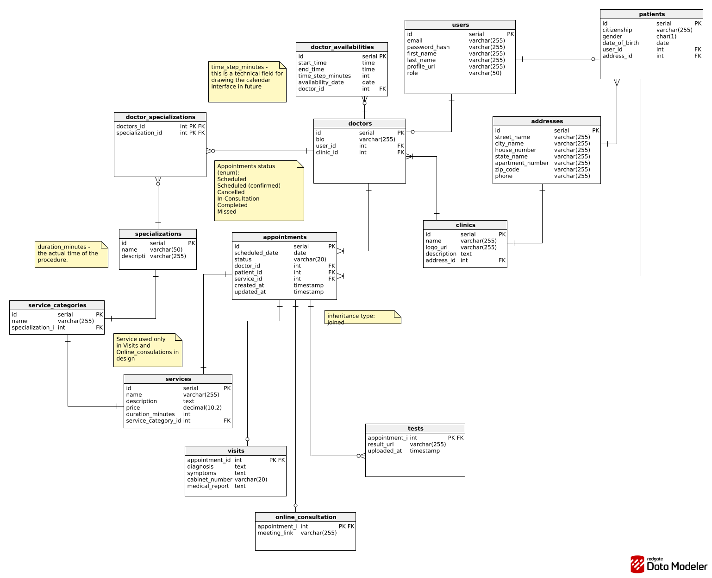

# Medfast API Documentation

## Accessing Swagger UI

The Medfast REST API provides **interactive documentation** using **Swagger/OpenAPI**.

#### Local Development

Open your browser and navigate to:
http://localhost:8080/swagger-ui/index.html

#### Features in Swagger UI

- Explore all available endpoints grouped by tags (Patients, Doctors, Appointments, etc.).
- View request/response models, status codes, and descriptions.
- **Try it out**: send test requests directly from the browser.
  - If endpoints require JWT authentication, click the **Authorize** button and provide your token.
- See **OpenAPI specification** in JSON or YAML format:
  - JSON: `http://localhost:8080/v3/api-docs`
  - YAML: `http://localhost:8080/v3/api-docs.yaml`

---

## Regenerating / Updating API Documentation

The OpenAPI specification is **generated automatically** from your Spring Boot controllers and annotations. To update it:

1. **Add or modify controllers/endpoints**, request/response models, or annotations (`@RestController`, `@GetMapping`, `@Parameter`, `@Schema`, etc.).
2. **Restart the application** to regenerate the OpenAPI spec.
3. **Verify changes** in Swagger UI or by accessing:
   - JSON: `/v3/api-docs`
   - YAML: `/v3/api-docs.yaml`

---

# MedFast PostgreSQL Docker Setup

## Description

This project provides a fully reproducible PostgreSQL environment with Flyway-based schema versioning.
Database initialization and migrations are automated using Docker Compose.

## Project Structure

```
.
├─ docker-compose.yml
├─ .env
├─ flyway/
│  └─ sql/
│     ├─ V1__create_tables.sql
│     ├─ V2__create_constraints.sql
│     ├─ V3__create_indexes.sql
│     └─ V4__seed_data.sql
└─ README.md
```
## Database ER Diagram


## Quick Start

### Start the Environment

```bash
docker compose up -d
```

* Starts the PostgreSQL container with persistent storage
* Automatically runs Flyway migrations

### Stop the Environment

```bash
docker compose down -v
```

* Removes containers, networks, and volumes

## Flyway Migrations

* Migration scripts are located in `flyway/sql/`
* Naming convention: `V<version>__<description>.sql`
* To run migrations manually:

```bash
docker compose run --rm flyway migrate
```

## Initialization Scripts

* Located in `docker-entrypoint-initdb.d/` (Postgres automatically executes them on first startup)
* Create schemas, tables, and seed essential data

## Configuration

* Configured via `.env` file:

```
POSTGRES_USER=medfast_user
POSTGRES_PASSWORD=medfast_password
POSTGRES_DB=medfast_db
POSTGRES_PORT=5432
```

## Notes

* Simply running `docker compose up` is sufficient; no manual steps are required.

---
## Integration Testing with Testcontainers

This project uses **Testcontainers** to spin up isolated PostgreSQL instances for integration testing.

### Running Tests
#### 1. Local Development
By default, running tests locally will use the `test` profile. This profile is configured to **reuse** the database container between runs to speed up execution.

**Prerequisites**

Even though the code enables reuse, **Testcontainers requires a global permission flag** on your machine.
1. Navigate to your home directory
2. Find (or create) file names .testcontainers.properties.
3. Add the following line to the file:
```properties
testcontainers.reuse.enable=true
```
**Without this file, Testcontainers will ignore the code settings**
#### 2. CI Mode
To run tests in a pristine environment, use the test-ci profile. This forces a fresh container for every run to ensure isolation.

**Example using mvn**
```bash
mvn verify "-Dspring.profiles.active=test-ci"
```

### Troubleshooting

#### Docker not running
Error: `IllegalStateException: Could not find a valid Docker environment`

Fix: Start Docker and retry.

#### Flyway checksum mismatch
Error: `org.springframework.beans.factory.BeanCreationException: ... Validate failed: Migrations have failed validation`

Possible Cause: You modified a SQL migration script after the test container had already run.

Fix: Manually destroy the reusable container to force a fresh start.

#### Container reuse not working
Check:
* Active profile is set to 'test'(default).
* ~/.testcontainers.properties exists with testcontainers.reuse.enable=true.
