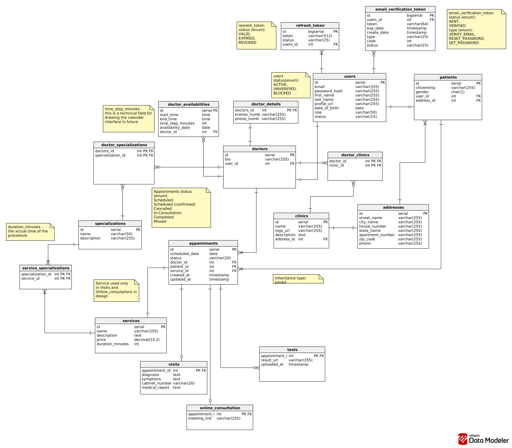

# Medfast API Documentation

## Accessing Swagger UI

The Medfast REST API provides **interactive documentation** using **Swagger/OpenAPI**.

#### Local Development

Open your browser and navigate to:
http://localhost:8080/api/swagger-ui/index.html

#### Features in Swagger UI

- Explore all available endpoints grouped by tags (Patients, Doctors, Appointments, etc.).
- View request/response models, status codes, and descriptions.
- **Try it out**: send test requests directly from the browser.
    - If endpoints require JWT authentication, click the **Authorize** button and provide your token.
- See **OpenAPI specification** in JSON or YAML format:
    - JSON: `http://localhost:8080/v3/api-docs`
    - YAML: `http://localhost:8080/v3/api-docs.yaml`

---

## Regenerating / Updating API Documentation

The OpenAPI specification is **generated automatically** from your Spring Boot controllers and annotations. To update it:

1. **Add or modify controllers/endpoints**, request/response models, or annotations (`@RestController`, `@GetMapping`, `@Parameter`, `@Schema`, etc.).
2. **Restart the application** to regenerate the OpenAPI spec.
3. **Verify changes** in Swagger UI or by accessing:
    - JSON: `/v3/api-docs`
    - YAML: `/v3/api-docs.yaml`

---

# MedFast PostgreSQL Docker Setup

## Description

This project provides a fully reproducible PostgreSQL environment with Flyway-based schema versioning.
Database initialization and migrations are automated using Docker Compose.

## Project Structure

```
.
├─ docker-compose.yml
├─ .env
├─ flyway/
│  └─ sql/
│     ├─ V1__create_tables.sql
│     ├─ V2__create_constraints.sql
│     ├─ V3__create_indexes.sql
│     └─ V4__seed_data.sql
└─ README.md
```

## Database ER Diagram



## Quick Start

### Start the Environment

```bash
docker compose up -d
```

* Starts the PostgreSQL container with persistent storage
* Automatically runs Flyway migrations

### Stop the Environment

```bash
docker compose down -v
```

* Removes containers, networks, and volumes

## Flyway Migrations

* Migration scripts are located in `flyway/sql/`
* Naming convention: `V<version>__<description>.sql`
* To run migrations manually:

```bash
docker compose run --rm flyway migrate
```

## Initialization Scripts

* Located in `docker-entrypoint-initdb.d/` (Postgres automatically executes them on first startup)
* Create schemas, tables, and seed essential data

## Configuration

* Configured via `.env` file:

```
POSTGRES_USER=medfast_user
POSTGRES_PASSWORD=medfast_password
POSTGRES_DB=medfast_db
POSTGRES_PORT=5432

GF_ADMIN_PASSWORD=admin
```

## Notes

* Simply running `docker compose up` is sufficient; no manual steps are required.

---

## Integration Testing with Testcontainers

This project uses **Testcontainers** to spin up isolated PostgreSQL instances for integration testing.

### Running Tests

#### 1. Local Development

By default, running tests locally will use the `test` profile. This profile is configured to **reuse** the database container between runs to speed up execution.

**Prerequisites**

Even though the code enables reuse, **Testcontainers requires a global permission flag** on your machine.

1. Navigate to your home directory
2. Find (or create) file names .testcontainers.properties.
3. Add the following line to the file:

```properties
testcontainers.reuse.enable=true
```

**Without this file, Testcontainers will ignore the code settings**

#### 2. CI Mode

To run tests in a pristine environment, use the test-ci profile. This forces a fresh container for every run to ensure isolation.

**Example using mvn**

```bash
mvn verify "-Dspring.profiles.active=test-ci"
```

### Troubleshooting

#### Docker not running

Error: `IllegalStateException: Could not find a valid Docker environment`

Fix: Start Docker and retry.

#### Flyway checksum mismatch

Error: `org.springframework.beans.factory.BeanCreationException: ... Validate failed: Migrations have failed validation`

Possible Cause: You modified a SQL migration script after the test container had already run.

Fix: Manually destroy the reusable container to force a fresh start.

#### Container reuse not working

Check:

* Active profile is set to 'test'(default).
* ~/.testcontainers.properties exists with testcontainers.reuse.enable=true.

## Git Pre-push Hooks

Our team uses in this project git pre-push hooks to execute scripts before pushing to remote origin.
Currently, we have 1 script file, which ensures project builds correctly

Scripts are stored in:

* ./.githooks/

### 1. How to install

#### Linux / macOS

For pre-push scripts to work correctly on Linux and macOS, you only need to install Git and Maven.

#### Windows

For Windows you should install Maven, Git and Git Bash. Git Bash is needed for executing shell scripts from .githooks

### 2. Setup

Scripts in .githooks must be marked as executable. Also You should set folder with pre-push scripts in your git.

You can execute following command to do that (Linux, macOS and Windows with Git Bash)

```
git config core.hooksPath .githooks
chmod +x .githooks/*
```

Or you can run bash script from (Linux, macOS and Windows with Git Bash)

* ./scripts/setup-hooks.sh

---

## Logging
The application logging is configured in `src/main/resources/logback-spring.xml`. This file defines environment-specific behaviors, log levels and sensitive data masking rules.

### How to Change Log Level at Runtime
We use Spring Boot Actuator to manage log levels dynamically without restarting the service.

**Base URL**: `http://localhost:8080/api/actuator/loggers`

#### Check the current log level:
To see log level for the application package:
```bash
curl http://localhost:8080/api/actuator/loggers/com.vention.medfast
```

#### Change Log Level
To enable `DEBUG` logs for the main application:
```bash
curl -i -X POST -H "Content-Type: application/json" \
  -d '{"configuredLevel": "DEBUG"}' \
  http://localhost:8080/api/actuator/loggers/com.vention.medfast
```

To enable `DEBUG` logs for Spring Security:
```bash
curl -i -X POST -H "Content-Type: application/json" \
  -d '{"configuredLevel": "DEBUG"}' \
  http://localhost:8080/api/actuator/loggers/org.springframework.security
```
### How to Enable SQL Logging

#### Enable SQL Query Logging:
```bash
curl -i -X POST -H "Content-Type: application/json" \
  -d '{"configuredLevel": "DEBUG"}' \
  http://localhost:8080/api/actuator/loggers/org.hibernate.SQL
```

#### Enable Bind Parameters(see values):
```bash
curl -i -X POST -H "Content-Type: application/json" \
  -d '{"configuredLevel": "TRACE"}' \
  http://localhost:8080/api/actuator/loggers/org.hibernate.orm.jdbc.bind
```

### Example of Log Formats
Stage(stage) - Console Output:
```
09:27:39.549 [http-nio-8080-exec-1] DEBUG c.v.m.auth.service.AuthServiceImpl - Authentication successful. Generating tokens for User ID: 1
09:27:39.729 [scheduling-1] DEBUG c.v.medfast.scheduled.LogsPoster - Debug message
09:27:39.797 [http-nio-8080-exec-1] DEBUG org.hibernate.SQL - insert into refresh_tokens (status,token,users_id) values (?,?,?)
```

Dev/Production(dev, prod) - JSON Output:
```JSON
{
  "Timestamp/UTC": "2025-12-15T08:22:49.043273Z",
  "service": "medfast_api",
  "version": "0.0.0",
  "env": "prod",
  "Level": "WARN",
  "Thread": "http-nio-8080-exec-3",
  "Logger": "com.vention.medfast.auth.service.AuthServiceImpl",
  "ServiceName": "default",
  "Class": "com.vention.medfast.auth.service.AuthServiceImpl",
  "Method": "login",
  "File": "AuthServiceImpl.java",
  "Line": 62,
  "Message": "Failed login attempt for email: admin@med.com - Bad Credentials"
}
```

## Observability
This project uses **Grafana, Loki** and **Promtail** to create observability stack. The goal is to provide developers with real-time log search and metric visualization.

### How to run the application
To launch the entire environment - PostgreSQL database, our application, and the monitoring stack - use one single command.

```bash
docker-compose up -d --build
```

**Confirm running services**
```bash
docker-compose ps
```

### How to access the Monitoring UI(Grafana)
The primary dashboard is available immediately upon successful startup:

|Service|Address| Role                                                                                                                |
|-------|---------------------|---------------------------------------------------------------------------------------------------------------------|
|Grafana|http://localhost:3000| The main dashboard used for viewing logs and basic metrics                                                          |
|Prometheus|http://localhost:9090/targets | Metrics status. Check this page to confirm Prometheus is successfully scraping metrics from all configured services |

### Viewing and Filtering Application Logs
Logs from the Spring Boot application are collected, parsed, and stored as structured JSON data in Loki.

#### Dashboard Filters
From the Grafana home dashboard, you can quickly filter logs using the dedicated panels:

- **Level Filter**: Select one or more log levels(e.g., `ERROR`, `WARN`, `INFO`) from the dropdown list.
- **Package Filter**: Enter a specific class or package, such as `com.vention.medfast.user`, to narrow results.

#### LogQL Query Structure(Advanced)
For precise filtering and searching, use the LogQL in Grafana's Explore view.

- `{container="medfast_api"} |= "Database connected"`: find logs containing text

---

## API Testing with Postman

### How to Setup
1. **Install Postman:** Download it from [postman.com/downloads](https://www.postman.com/downloads/)
2. **Import Collection and Environment:**
   * To import your data into Postman, click Import in the sidebar
   * Drag and drop the `postman/medfast-api-postman-collection.json` and `postman/dev-postman-env.json` files

### How to Run Tests
1. **Select Environment:** in the top right corner of Postman, change the dropdown from "No Environment" to **Dev** (environment you imported).
2. **Run the Collection:**
   * Select the **Medfast API** collection folder.
   * Click the **Run** button (top right).
   * **IMPORTANT:** In the Runner settings, set **Delay** to `200ms`. This prevents database race conditions during token rotation.
   * Click **Run the Medfast API**.
